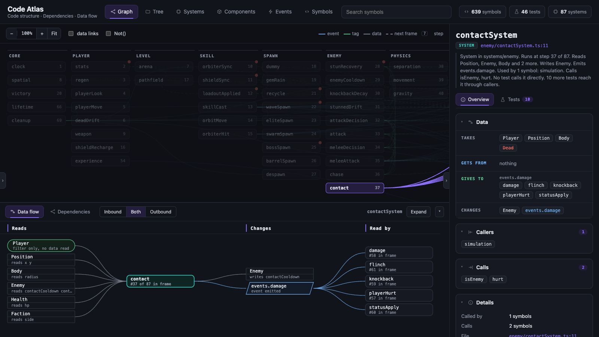
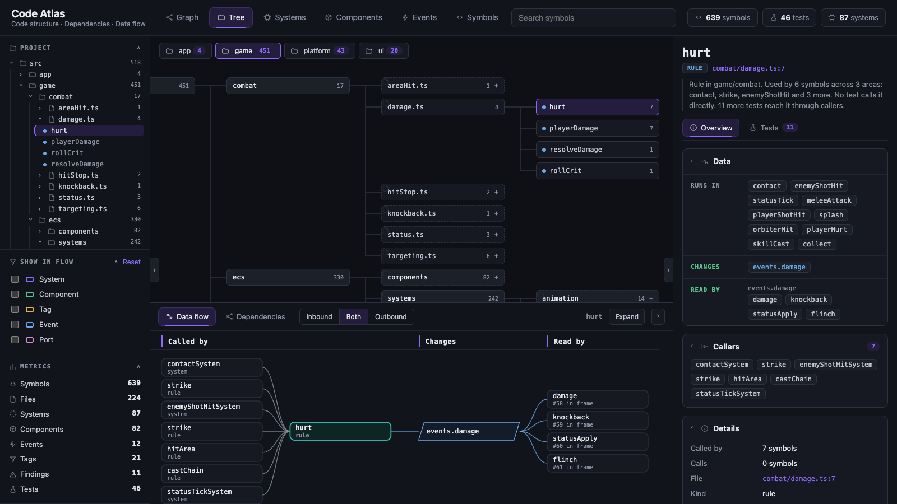

# code-atlas

A living map of a TypeScript project, built by the compiler, for people and for AI agents.



## What it does

code-atlas reads your project with the TypeScript compiler and writes down how it really works. Every function, class, method, hook and component. Who calls it and what it calls. Which tests reach it. For ECS games it goes further and records every system in frame order, the components it reads and writes field by field, the tags and events it sends, and which systems see those changes, including the ones that see them one frame late.

Every fact points to a file and a line. Nothing is written by hand and nothing is guessed from names.

## What your project turns into

- **One JSON file** next to the code, `docs/code-atlas/code-atlas.json`. Think of it as OpenAPI for your code instead of for an HTTP API. It is rebuilt from the code, so it never goes stale.
- **A viewer** in the browser. The frame or the most used code by folder, a tree of the project, sortable tables and a card for every symbol with its callers, calls, tests and docs. A click on any location opens your editor on that line.
- **Short answers for agents.** One command tells an agent what a change will break, which tests to run, what a system does and which code needs docs the most.



## The problem it solves

Architecture docs go out of date within a week. Text search finds words, not calls, so it misses calls through re-exports and package aliases and mixes up functions with the same name. An AI agent that learns a project by searching reads dozens of files for every question and still misses things.

code-atlas gives both people and agents the same exact picture, kept fresh by the build.

## Start

```
npm install --save-dev code-atlas
npx code-atlas init
npx code-atlas build
npx code-atlas serve
```

To try the latest code from GitHub, install `github:DmitriyGolub/code-atlas` instead.

`init` finds your folders, tests and ECS layout, writes `code-atlas.config.json`, adds the agent skill to `.claude/skills/` and a short section to `CLAUDE.md` or `AGENTS.md`. Pass `--agents no` to skip the agent part. A project without ECS gets a map of calls between functions.

## Supported stacks

| Stack | What the map shows |
|---|---|
| ECS in the bitecs style, where a component is a set of arrays read as `Position.x[entity]` | systems in frame order, component data flow, tags, events, findings |
| ECS with an object API, such as `world.getComponent(entity, Position)` and `world.addSystem(new MoveSystem())` | the same, with the frame taken from the order of `addSystem` calls and fields taken from destructuring |
| React, Next.js, Vite, Express, Node | functions, hooks, components, who calls whom, tests |
| NestJS, Angular | classes with their methods, decorators such as controller, service, module, endpoint and component, calls through dependency injection |
| npm, pnpm and yarn workspaces | every package with its own tsconfig, `exports` and path aliases |

## For agents

`init` gives the agent a skill and a few lines in `CLAUDE.md` or `AGENTS.md`. Other tools can read [`llms.txt`](llms.txt). The routine is simple.

1. Before a change, run `npx code-atlas impact <symbol>` and name the affected code and tests in the plan.
2. After the change, run `npx code-atlas diff` and report what changed in the structure.
3. To improve the docs, run `npx code-atlas docs`. It lists exported symbols without a `/** */` comment, the most used first. The agent writes one or two sentences above each, and the viewer shows them on the symbol card after the next build.

Symbols without a comment still get a short summary built from the code, marked as generated.

## Commands

| Command | What it does |
|---|---|
| `init` | finds the layout and writes the config, add `--print yes` to only show it |
| `build` | writes the map, its schema and the viewer |
| `check` | fails when the map is older than the code, for CI |
| `impact <symbol>` | callers, the code that runs it, what it changes, who reads that, tests |
| `focus <system>` | one ECS system with its docs, data, rules, tests and neighbours |
| `diff [ref]` | what changed in the structure since `ref`, add `--strict yes` to fail on new findings |
| `findings` | ECS warnings, see below |
| `docs` | exported symbols without a doc comment, most used first |
| `serve` | the viewer, add `--editor cursor` or `webstorm` or `zed` for links |

## Keeping the map fresh

The output is deterministic. A rebuild without code changes writes the same bytes, and a small edit changes a few lines of the map. To rebuild on every commit, add a pre-commit hook.

```sh
# .githooks/pre-commit
if git diff --cached --name-only | grep -qE '^(src|tests)/'; then
  npx code-atlas build > /dev/null && git add docs/code-atlas
fi
```

Add `docs/code-atlas/** linguist-generated=true` to `.gitattributes`, so GitHub folds the map in pull requests. In CI run `npx code-atlas check`.

You can also keep the map out of git and build it when you need it. Agents do not read the file anyway, their commands analyse the code directly.

## Large projects

By default the map is one file. For a monorepo or a map of several megabytes set `"split": "auto"` in the config. You get `index.json` with the list of packages and the calls between them, plus one file per package. A change in one package rewrites only its file and the index. The viewer joins the files and adds a Modules view.

## ECS findings

| Finding | Meaning |
|---|---|
| `next-frame` | a system reads a tag or event before the system that writes it runs, so it reacts one frame late |
| `wide` | a system changes many components at once |
| `write-only` | a field is written and never read |

A finding that is fine for your game goes to `findings.accepted` with a reason. `diff --strict yes` fails only on new findings.

## Configuration

`code-atlas.config.json`, every key is optional, see [`schema/config.schema.json`](schema/config.schema.json). The main keys are `sources`, `tests`, `layers` for the ECS folders, `conventions` for names such as the system suffix and the query factory, and `pipeline` for the file that orders the frame.

Tests next to the code (`*.test.ts`, `*.spec.ts`, `*.e2e.ts`) are found on their own. Tests in another folder, such as `.qa/`, go into `tests`, and another test function name goes into `testRunners`. The symbol card lists the tests that call a symbol and, separately, the tests that reach it through callers.

## Text search versus code-atlas

Three questions an agent asks all the time, measured on our own ECS game.

| Question | Text search | code-atlas |
|---|---|---|
| What breaks if `hurt` changes | 24 lines in 14 files, about 34 KB to read. The 4 systems that read the event `hurt` writes are never found, they do not mention `hurt` | one command, 38 lines. The 7 callers, the 10 systems that run it, the event it writes, its 4 readers and the tests |
| Who uses what `contactSystem` produces | 4 lines in 3 files, only the places that mention its name, nothing about who reads its output | one command, 27 lines. The fields and the event it writes and the 5 systems that read them |
| Who writes and reads `Health` | 63 lines in 22 files, about 41 KB to read, reads and writes mixed together | one command. 9 systems that write it and 19 that read it, field by field, and 7 tests |

With text search an agent has to open those files, tell reads from writes and search again for every new name it finds. That takes many steps and a lot of context, and calls through events, re-exports and package aliases stay invisible. With code-atlas the answer is one command and a few kilobytes, and it is exact because the compiler resolved every call. The agent still reads the code it is about to change, the map tells it where to look.

## Limits

- A field picked at runtime, such as `Stats[stat][player]`, shows up as `Stats.*`.
- The frame order comes from arrays of systems. Systems called one by one are shown without an order, their data links are still drawn.
- Inline `query(world, [...])` calls are not shown as queries, constants made by the query factory are.
- The analysis is static. What is decided at runtime is covered by tests.

## TODO

- Systems that come from a compiled library are placed in the frame by name, what they read and write inside stays unknown.
- ECS libraries with other access styles, such as miniplex property access on entities.
- Vue and Svelte single file components, today only `.ts` and `.tsx` are read.
- Calls from Angular `.html` templates into the component.
- Reuse a fresh map in `impact` and `focus`, so large projects answer at once.

## Improving code-atlas

The analyzer lives in `src/analyze`, the viewer in `ui/src`. `npm run build:ui` rebuilds the viewer into `viewer/`, `npm run check:ui` type checks it, `npm test` runs the analyzer on the projects in `test/fixtures`. CI checks all three on every push. A GitHub release publishes the package to npm. Every source file stays under 150 lines, and rules such as test folders and skipped folders are config keys rather than code. A change to the analyzer should leave the maps of existing projects byte for byte the same unless it adds information on purpose.

MIT
